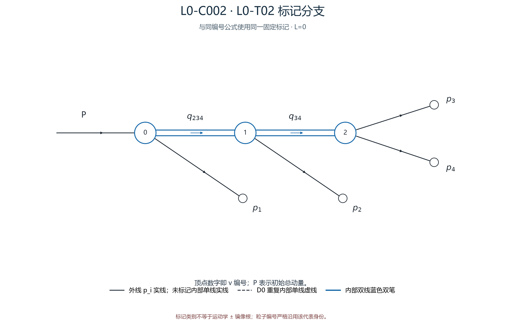

## 审阅导航

- 类别：`L0-C002`；圈数：`0`；审阅状态：**待人工审阅**。
- 母拓扑：[L0-T02](../拓扑/L0-T02.md)；同拓扑共 1 个标记类。
- 图像清单：[../01_图清单.md](../01_图清单.md)；公式清单：[../02_公式清单.md](../02_公式清单.md)；人工记录：[../03_人工审阅记录.md](../03_人工审阅记录.md)。
- 本类代表大图：[PNG](../assets/branches/L0-C002.png) · [SVG](../assets/branches/L0-C002.svg)。
- 完整机器证据：ZIP 内 `run04/L0-C002_L0-T02.evidence.json`；[原始公式与完整证据 ZIP](../资料/原始公式与证据_run04.zip)。
- 公式构建：direct `built`；树协变 `built`。
- 有限样本状态：本地 `verified_local`；Yu2022 `verified_local`。详细计数见 [公式清单](../02_公式清单.md) 与 [验证边界](../资料/来源与验证边界.md)。
- 状态只描述已有机器证据；尚未由人工逐式验收。

---

<!-- 以下是冻结的六步公式 Markdown 正文；组装器只在其前添加导航和代表图。 -->

# L0-C002 四体 L=0 标记公式

## 标记来源与验证状态

- 拓扑：`L0-T02`；loop：L=0；d=2。
- 代表 fixed digest：`33f4515ad32b1e705e453b7593b8e9c3f087d4aa9fd53387e65102fda08ab842`；particle-relabeling digest：`8e293a5055ebdbff6117872c89820ca9d3d3b0b841aafb2d43370df7b231b66f`。
- 类内 fixed 身份：12 条；fixed → representative 的逐项映射见 `.evidence.json`。
- 公式构建：`built`；树 trace：`built`。
- benchmark：`verified_local`；本次没有把 pending 升级为通过。
- 论文来源对照状态：`not_checked`；生成档案不构成外部来源验证。

- 代表 fixed 记录的完整图、变量、局部因子与成员映射保存在 [原始公式与完整证据 ZIP](../资料/原始公式与证据_run04.zip)。

### 标记图与连接表

- 初始顶点：`v0`；终态粒子：`p1@v0`, `p2@v1`, `p3@v2`, `p4@v2`
- 图编码来自本类代表 fixed 记录；边索引与 occurrence 沿用输入卡。

| edge | source → target | 类型 | occurrence 标记 |
|---:|---|---|---|
| e0 | v0 → v1 | double × 1 | o0: {p2,p3,p4} |
| e1 | v1 → v2 | double × 1 | o0: {p3,p4} |

- 有序 IKV：`s234, s34`。
- 输入测度约定：`jing_psf`；公式来源状态：`not_checked`。

## 1. 原图表达式：3 个二体块与 2 条双线测度

逐个顶点列出真实局部因子、出射测度、顶点守恒和原始 delta。

### 顶点 $v_{0}$

$$
\delta^{(4)}\!\left((P)-(p_{1})-(q_{1,1})\right)\,\frac{\mathrm{d}^4 p_{1}\,\delta\!\left((p_{1})^2-m_{1}^{2}\right)\,\theta\!\left(p_{1}^0\right)}{(2\pi)^3}\,\frac{\mathrm{d}^4 q_{1,1}\,\delta\!\left((q_{1,1})^2-s_{234}\right)\,\theta\!\left(q_{1,1}^0\right)}{(2\pi)^3}
$$

- 守恒方程：$P = p_{1} + q_{1,1}$
- 输入动量：$P$
- 出射积分动量：$p_{1}\; , \;q_{1,1}$
- 壳支撑动量：$p_{1}\; , \;p_{2} + p_{3} + p_{4}$
- 原顶点 delta：$\delta^{(4)}\!\left((P)-(p_{1})-(q_{1,1})\right)$
- 局部 $2\pi$ 次幂：`0`

### 顶点 $v_{1}$

$$
\delta^{(4)}\!\left((q_{1,1})-(p_{2})-(q_{2,1})\right)\,\frac{\mathrm{d}^4 p_{2}\,\delta\!\left((p_{2})^2-m_{2}^{2}\right)\,\theta\!\left(p_{2}^0\right)}{(2\pi)^3}\,\frac{\mathrm{d}^4 q_{2,1}\,\delta\!\left((q_{2,1})^2-s_{34}\right)\,\theta\!\left(q_{2,1}^0\right)}{(2\pi)^3}
$$

- 守恒方程：$q_{1,1} = p_{2} + q_{2,1}$
- 输入动量：$q_{1,1}$
- 出射积分动量：$p_{2}\; , \;q_{2,1}$
- 壳支撑动量：$p_{2}\; , \;p_{3} + p_{4}$
- 原顶点 delta：$\delta^{(4)}\!\left((q_{1,1})-(p_{2})-(q_{2,1})\right)$
- 局部 $2\pi$ 次幂：`0`

### 顶点 $v_{2}$

$$
\delta^{(4)}\!\left((q_{2,1})-(p_{3})-(p_{4})\right)\,\frac{\mathrm{d}^4 p_{3}\,\delta\!\left((p_{3})^2-m_{3}^{2}\right)\,\theta\!\left(p_{3}^0\right)}{(2\pi)^3}\,\frac{\mathrm{d}^4 p_{4}\,\delta\!\left((p_{4})^2-m_{4}^{2}\right)\,\theta\!\left(p_{4}^0\right)}{(2\pi)^3}
$$

- 守恒方程：$q_{2,1} = p_{3} + p_{4}$
- 输入动量：$q_{2,1}$
- 出射积分动量：$p_{3}\; , \;p_{4}$
- 壳支撑动量：$p_{3}\; , \;p_{4}$
- 原顶点 delta：$\delta^{(4)}\!\left((q_{2,1})-(p_{3})-(p_{4})\right)$
- 局部 $2\pi$ 次幂：`0`

### 双线 $ds$ 因子

| edge / occurrence | 实际因子 |
|---|---|
| e0/o0 | $(2\pi)^3\,\mathrm{d}s_{234}$ |
| e1/o0 | $(2\pi)^3\,\mathrm{d}s_{34}$ |

### D0 重复末态测度账目

- 策略：`D0: retain each unique external particle measure; cancel every repeated internal single-line measure`；实际取消 0 个内部单线副本，保留 4 个外线单粒子测度。
- 保留外线粒子 `[1]`，位于 v0/slot0。
- 保留外线粒子 `[2]`，位于 v1/slot0。
- 保留外线粒子 `[3]`，位于 v2/slot0。
- 保留外线粒子 `[4]`，位于 v2/slot1。

### 原图局部归一化账

$$
\left[(2\pi)^3(2\pi)^{-3}\right]^{2}=1,\qquad \prod_{i=1}^{4}\frac{\mathrm{d}^4p_i\,\delta(p_i^2-m_i^2)\,\theta(p_i^0)}{(2\pi)^3}
$$

$$
(2\pi)^3(2\pi)^{-3}=1
$$

$$
\prod_{i=1}^{4}\mathrm{d}\mu(p_i)=\frac{\prod_i\mathrm{d}^4p_i\,\delta(p_i^2-m_i^2)\theta(p_i^0)}{(2\pi)^{12}}
$$

## 2. 实际逐叶消元、根守恒与壳转移

- 从实际双线树执行 2 次四维 delta 消元；D0 取消 0 个内部单线副本。

### q 消元 1：v2 → v1

- 原顶点 delta：$\delta^{(4)}\!\left((q_{2,1})-(p_{3})-(p_{4})\right)$
- 经先前代入后的当前约束：$-p_{3} - p_{4} + q_{2,1} = 0$
- 积分变量：$q_{2,1}$
- 实际代入：$q_{2,1} = p_{3} + p_{4}$
- 四维绝对 Jacobian：$\left\vert \det(\pm I_4)\right\vert =1$

### q 消元 2：v1 → v0

- 原顶点 delta：$\delta^{(4)}\!\left((q_{1,1})-(p_{2})-(q_{2,1})\right)$
- 经先前代入后的当前约束：$-p_{2} - p_{3} - p_{4} + q_{1,1} = 0$
- 积分变量：$q_{1,1}$
- 实际代入：$q_{1,1} = p_{2} + p_{3} + p_{4}$
- 四维绝对 Jacobian：$\left\vert \det(\pm I_4)\right\vert =1$

- 根方程：$P = p_{1} + p_{2} + p_{3} + p_{4}$
- 根残差：$P - p_{1} - p_{2} - p_{3} - p_{4} = 0$
- 剩余 q 变量：$\varnothing$

### q 壳转移与保留 ds

#### $q_{1,1}$

- 树内解：$q_{1,1} = p_{2} + p_{3} + p_{4}$
- 用根守恒得到的支撑：$q_{1,1} = p_{2} + p_{3} + p_{4}$
- 在壳 delta：$\delta\!\left((p_{2} + p_{3} + p_{4})^2-s_{234}\right)$
- 正能量条件：$\theta\!\left((p_{2} + p_{3} + p_{4})^0\right)$
- 保留 ds：$\mathrm{d}s_{234}$

#### $q_{2,1}$

- 树内解：$q_{2,1} = p_{3} + p_{4}$
- 用根守恒得到的支撑：$q_{2,1} = p_{3} + p_{4}$
- 在壳 delta：$\delta\!\left((p_{3} + p_{4})^2-s_{34}\right)$
- 正能量条件：$\theta\!\left((p_{3} + p_{4})^0\right)$
- 保留 ds：$\mathrm{d}s_{34}$

### 剩余整体守恒与原图 IKV 约束

$$
\delta^{(4)}\!\left(P-p_1-p_2-p_3-p_4\right)
$$

$$
\delta\!\left(s_{234}-(p_{2} + p_{3} + p_{4})^2\right) \theta\!\left((p_{2} + p_{3} + p_{4})^0\right)
$$

$$
\delta\!\left(s_{34}-(p_{3} + p_{4})^2\right) \theta\!\left((p_{3} + p_{4})^0\right)
$$

## 3. 以子系统角定义的低圈坐标与精确线性换元

- chart profile/status：`direct_gram_low_loop` / `built`。
- 原图变量：$\mathbf S=(s_{234},\;s_{34})^{\mathsf T}$。
- 保留内部角：$(x,\;y,\;\varphi)$；总转动角：$(\theta,\;\phi,\;\psi)$。

### 子系统质量与补足坐标

- 显式 $h(S)$：$s_{34} = s_{34}$
- 显式 $t(S)$：$s_{234} = s_{234}$

### 原图 IKV 到 $(h,t,U)$ 的可逆仿射换元

- 补足变量次序：$\mathbf B=(s_{34},\;s_{234})^{\mathsf T}$。

$$
\mathbf B=K\mathbf S+\mathbf b_B
$$

$$
K=\begin{pmatrix}0 & 1 \\ 1 & 0\end{pmatrix}
$$

- $\det K=-1$；固定质量的仿射偏移逐行保存在机器证据 JSON。

### 五个完整不变量与回到基底变量的映射

- $\mathbf Z=(s_{34},\;s_{234},\;s_{23},\;s_{134},\;s_{13})^{\mathsf T}$。
- 基底变量：$\mathbf X=(s_{234},\;s_{13},\;s_{24},\;s_{12},\;s_{34})^{\mathsf T}$。

$$
\mathbf Z=A_Z\mathbf X+\mathbf b_Z,\qquad{}\mathbf X=A_Z^{-1}(\mathbf Z-\mathbf b_Z)
$$

$$
A_Z=\begin{pmatrix}0 & 0 & 0 & 0 & 1 \\ 1 & 0 & 0 & 0 & 0 \\ 1 & 0 & -1 & 0 & -1 \\ -1 & 0 & 0 & -1 & 1 \\ 0 & 1 & 0 & 0 & 0\end{pmatrix}
$$

$$
A_Z^{-1}=\begin{pmatrix}0 & 1 & 0 & 0 & 0 \\ 0 & 0 & 0 & 0 & 1 \\ -1 & 1 & -1 & 0 & 0 \\ 1 & -1 & 0 & -1 & 0 \\ 1 & 0 & 0 & 0 & 0\end{pmatrix}
$$

- $D=|\det A_Z|=1$。
- 实际 affine 形式：$s_{34} = s_{34}$
- 实际 affine 形式：$s_{234} = s_{234}$
- 实际 affine 形式：$s_{23} = s_{234} - s_{24} - s_{34} + m_2^2 + m_3^2 + m_4^2$
- 实际 affine 形式：$s_{134} = -s_{234} - s_{12} + s_{34} + M^2 + m_1^2 + m_2^2$
- 实际 affine 形式：$s_{13} = s_{13}$

### 实际 $J_x,J_y,v$ 角展开系数与运动学辅助量

- 实际局部粒子次序及质量符号：

$$
(a,b,c,d)=(3,4,2,1),\quad{}(m_a,m_b,m_c,m_d)=(m_{3},m_{4},m_{2},m_{1})
$$

- 所选模式：`nested`；其局部轴、余弦角和有向方位角定义为：

$$
\text{nested mode in the }Q_{abc}\text{ rest frame:}\quad{}p_c\parallel +\hat z,\quad q_{ab}\parallel-\hat z;\quad{}x=\cos\angle(\mathbf p_a^{(ab)\,\mathrm{rest}},+\hat z),\quad{}y=\cos\angle(\mathbf p_d^{(abc)},\mathbf p_c^{(abc)}),\quad{}\varphi=\varphi_d-\varphi_a,\quad{}\varphi_a=0,\ \varphi_d=\varphi
$$

$$
h=s_{34},\quad t=s_{234},\quad J_x=s_{23},\quad J_y=s_{134},\quad v=s_{13}
$$

$$
J_x=j_{x0}+j_{x1}x
$$

$$
J_y=j_{y0}+j_{y1}y
$$

$$
v=v_0+v_xx+v_yy+v_{xy}xy+v_w\sqrt{1-x^2}\sqrt{1-y^2}\cos\varphi
$$

系数：

$$
j_{x0}=m_a^2+m_c^2+\frac{2e_a(E_qE_c+k^2)}{H}
$$

$$
j_{x1}=-\frac{2k_akT}{H}
$$

$$
j_{y0}=h+m_d^2+2E_qE_d
$$

$$
j_{y1}=2kk_d
$$

$$
v_0=m_a^2+m_d^2+\frac{2E_qe_aE_d}{H}
$$

$$
v_x=-\frac{2kk_aE_d}{H}
$$

$$
v_y=\frac{2ke_ak_d}{H}
$$

$$
v_{xy}=-\frac{2E_qk_ak_d}{H}
$$

$$
v_w=-2k_ak_d
$$

辅助量：

$$
H=\sqrt{h},\quad T=\sqrt{t},\quad k=\frac{\sqrt{\lambda(t,h,m_c^2)}}{2T}
$$

$$
E_q=\frac{t+h-m_c^2}{2T},\quad E_c=\frac{t+m_c^2-h}{2T}
$$

$$
E_d=\frac{M^2-t-m_d^2}{2T},\quad k_d=\sqrt{E_d^2-m_d^2}
$$

$$
e_a=\frac{h+m_a^2-m_b^2}{2H},\quad k_a=\sqrt{e_a^2-m_a^2}
$$

## 4. 实际角约束、解析消元与全部方位角根

### 由剩余原图 IKV 得到的全部 $C$ 约束

- 本类没有剩余内部 $C$ 行（$d=2$）；$x,y,\varphi$ 三个内部坐标均显式保留。
- $C\in\mathbb{R}^{0\times3}$，空子式行列式按 $1$ 处理。

### 实际消元列、保留角与 Jacobian

- 消元列：$()$；保留内部坐标：$(x,\;y,\;\varphi)$。
- 基底行列式：$\det(C_E)_{\rm base}=1$。
- 尺度化行列式：$\vert \det C_E\vert =1$。
- 选列先依据精确结构有理矩阵；实际约束 determinant 在该结构 determinant 上乘已列出的 $j_{x1},j_{y1}$ 次幂。

### 逐行求出被消去变量

- 没有内部约束行；$x,y,v$ 对应坐标保留，不做线性消元。

### 方位角根或保留角输入

$$
\varphi\text{ is retained on }(0,2\pi),\quad{}\varphi\ne\pi
$$

$$
\varphi\text{ is an explicit coordinate on }(0,2\pi),\quad{}\varphi\ne\pi
$$

## 5. 实际动量支、正能条件与开域

### Gram 正定与坐标开域

$$
m_i>0\ (i=1,2,3,4),\quad{}M>\sum_{i=1}^4m_i
$$

$$
E_i>0\ (i=1,2,3,4),\quad{}H_{11}>0,\quad{}H_{11}H_{22}-H_{12}^2>0,\quad{}\det H>0
$$

$$
\vert x\vert <1,\quad{}\vert y\vert <1,\quad{}j_{x1}j_{y1}\ne0,\quad{}\det C_E\ne0
$$

$$
0<\theta<\pi,\quad{}0\le\phi<2\pi,\quad{}0\le\psi<2\pi
$$

$$
0<\varphi<2\pi,\quad{}\varphi\ne\pi
$$

$$
\lambda>0\text{ for every selected strict two-body subsystem decay}
$$

### 所选子系统的严格阈值

$$
\lambda(x,y,z)=x^2+y^2+z^2-2xy-2xz-2yz
$$

$$
H>m_a+m_b,\quad{}T>H+m_c,\quad{}M>T+m_d,\qquad{}\lambda(h,m_a^2,m_b^2)>0,\quad{}\lambda(t,h,m_c^2)>0,\quad{}\lambda(M^2,t,m_d^2)>0
$$

### 已列开域条件对应的显式指示函数

- $\mathcal D$ 是本节列出的严格质量阈值、正能、Gram 正定、非零坐标系数与消元主元、Euler 角以及内部角条件的交集；$\mathcal D_{\rm rest}$ 的指标是其余已列条件指标的乘积。

$$
\Theta_+(u)=\mathbf 1_{u>0},\quad{}B_{(a,b)}(u)=\Theta_+(u-a)\Theta_+(b-u)
$$

$$
\chi_{\rm open}=\mathbf 1_{\mathcal D}=\mathbf 1_{\mathcal D_{\rm rest}}B_{(-1,1)}(x)B_{(-1,1)}(y)\,B_{(0,2\pi)}(\varphi)\,\mathbf 1_{\varphi\ne\pi}
$$

### 质心系动量重建、提升与整体转动

$$
H=\sqrt{h},\quad T=\sqrt{t},\quad k=\frac{\sqrt{\lambda(t,h,m_c^2)}}{2T}
$$

$$
E_q=\frac{t+h-m_c^2}{2T},\quad E_c=\frac{t+m_c^2-h}{2T},\quad E_d=\frac{M^2-t-m_d^2}{2T},\quad k_d=\sqrt{E_d^2-m_d^2}
$$

$$
e_a=\frac{h+m_a^2-m_b^2}{2H},\quad k_a=\sqrt{e_a^2-m_a^2}
$$

$$
p_a^{(abc)}=\left(\frac{E_qe_a-k k_ax}{H},\ k_a\sqrt{1-x^2},\ 0,\ \frac{E_qk_ax-ke_a}{H}\right)
$$

$$
p_b^{(abc)}=(E_q,0,0,-k)-p_a^{(abc)},\quad p_c^{(abc)}=(E_c,0,0,k)
$$

$$
p_d^{(abc)}=(E_d,k_d\sqrt{1-y^2}\cos\varphi,k_d\sqrt{1-y^2}\sin\varphi,k_dy)
$$

$$
\beta=-\frac{\mathbf p_d^{(abc)}}{T+E_d},\quad p_i^{(P)}=\operatorname{Boost}_{\beta}(p_i^{(abc)})\quad(i=a,b,c,d)
$$

$$
\boldsymbol\beta=-\frac{\mathbf p_d^{(abc)}}{T+E_d},\quad{}p_i^{(P)}=\operatorname{Boost}_{\boldsymbol\beta}\!\left(p_i^{(abc)}\right)\quad(i=a,b,c,d)
$$

$$
E'=\gamma(E+\boldsymbol\beta\!\cdot\mathbf p),\quad{}\mathbf p'=\mathbf p+\left[\frac{(\gamma-1)(\boldsymbol\beta\!\cdot\mathbf p)}{\vert \boldsymbol\beta\vert ^2}+\gamma E\right]\boldsymbol\beta,\quad{}\gamma=(1-\vert \boldsymbol\beta\vert ^2)^{-1/2},\quad{}\boldsymbol\beta=0\Rightarrow\operatorname{Boost}_{\boldsymbol\beta}=I
$$

- 下面的正交架将 $p_1$ 定为 $+z$，并使 $p_2$ 落在 $xz$ 平面且 $p_{2x}>0$。

$$
\mathbf e_z=\frac{\mathbf p_1^{(P)}}{\vert \mathbf p_1^{(P)}\vert },\quad{}\mathbf e_x=\frac{\mathbf p_2^{(P)}-(\mathbf p_2^{(P)}\!\cdot\mathbf e_z)\mathbf e_z}{\vert \mathbf p_2^{(P)}-(\mathbf p_2^{(P)}\!\cdot\mathbf e_z)\mathbf e_z\vert },\quad{}\mathbf e_y=\mathbf e_z\times\mathbf e_x
$$

$$
\mathbf k_i^{\rm body}=(\mathbf p_i^{(P)}\!\cdot\mathbf e_x,\mathbf p_i^{(P)}\!\cdot\mathbf e_y,\mathbf p_i^{(P)}\!\cdot\mathbf e_z),\quad{}p_i^{\rm body}=(E_i,\mathbf k_i^{\rm body})
$$

$$
R_{zyz}=R_z(\phi)R_y(\theta)R_z(\psi),\quad{}\begin{pmatrix}E_i\\\mathbf p_i^{\rm lab}\end{pmatrix}=\begin{pmatrix}1&0\\0&R_{zyz}\end{pmatrix}\begin{pmatrix}E_i\\\mathbf k_i^{\rm body}\end{pmatrix}
$$

$$
\text{the shape-dependent body frame only reselects the }SO(3)\text{ fiber base point; }dR\text{ is Haar invariant, so }J_{\rm rot}=1\text{ and no extra rotation Jacobian is included}
$$

### Gram 重建公式

- `energies`：

$$
E_1=\frac{M^2+m_1^2-s_{234}}{2M}
$$

- `energies`：

$$
E_2=\frac{s_{12}+s_{234}-s_{34}-m_1^2}{2M}
$$

- `energies`：

$$
E_3=\frac{s_{13}+s_{234}-s_{24}-m_1^2}{2M}
$$

- `energies`：

$$
E_4=M-E_1-E_2-E_3
$$

- `pair_completion`：

$$
s_{23}=s_{234}-s_{24}-s_{34}+m_2^2+m_3^2+m_4^2
$$

- `H`：

$$
H_{ii}=E_i^2-m_i^2,\quad{}H_{ij}=E_iE_j-\frac{s_{ij}-m_i^2-m_j^2}{2}\quad(i<j\in\{12,13,23\})
$$

- `strict_support`：

$$
E_i>0,\quad{}H_{11}>0,\quad{}H_{11}H_{22}-H_{12}^2>0,\quad{}\det H>0
$$

- `X_from_Z`：

$$
X=A_Z^{-1}(Z-b_Z),\quad{}Z=(h,t,J_x,J_y,v)
$$

### 构造状态

- 精确仿射秩：`passed exactly by Fraction row reduction`；pivot：`selected from exact structural rational columns before jx1/jy1 factors`。
- 数值事件与独立公式核验：`pending; chart construction does not imply an evaluated physical point` / `pending`。
## 6. Gram 拉回后的原图单支密度与完整微分

### 实际密度系数与坐标 Jacobian

- 归一化 `jing_psf` 对应 $p=12$。

$$
\rho_X=\frac{\chi_{\rm open}}{512(2\pi)^{12}M^3\sqrt{\det H}}
$$

$$
J_{\rm pull}=\frac{\vert j_{x1}j_{y1}\det K\vert }{D\vert \det C_E\vert }W
$$

$$
\rho_{\rm low}=\frac{\chi_{\rm open}\vert j_{x1}j_{y1}\det K\vert W}{512(2\pi)^{12}M^3\sqrt{\det H}\,D\vert \det C_E\vert }
$$

$$
W=\vert v_w\vert \sqrt{1-x^2}\sqrt{1-y^2}\vert \sin\varphi\vert \quad(\varphi\text{ retained})
$$

### 单支密度与微分测度

$$
d\Phi_4=\rho_{\rm low}\,d^dS\,dx dy d\varphi\,dR,\quad{}dR=\sin\theta\,d\theta\,d\phi\,d\psi
$$

$$
\rho_{\rm low}=\frac{\chi_{\rm open}\vert j_{x1}j_{y1}\det K\vert W}{512(2\pi)^{12}M^3\sqrt{\det H}D\vert \det C_E\vert }
$$

- direct formula status：`built`；来源状态仍为 `not_checked`。
## 可追溯记录

- 机器证据保留代表记录、所有 fixed 成员、粒子/顶点映射、输入卡、实际树消元、坐标数据与公式状态。
- 记录粒子换名只描述类成员到代表的显式映射，不合并或丢弃 fixed 身份。
