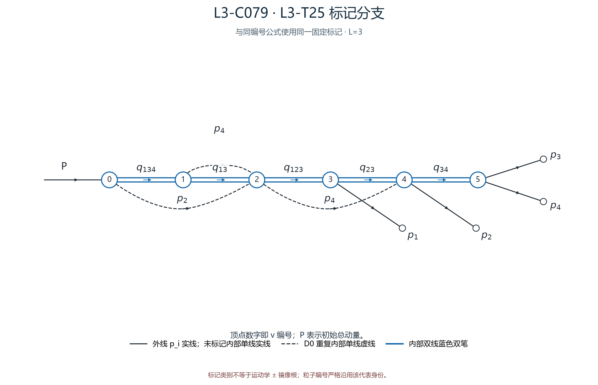

## 审阅导航

- 类别：`L3-C079`；圈数：`3`；审阅状态：**待人工审阅**。
- 母拓扑：[L3-T25](../拓扑/L3-T25.md)；同拓扑共 4 个标记类。
- 图像清单：[../01_图清单.md](../01_图清单.md)；公式清单：[../02_公式清单.md](../02_公式清单.md)；人工记录：[../03_人工审阅记录.md](../03_人工审阅记录.md)。
- 本类代表大图：[PNG](../assets/branches/L3-C079.png) · [SVG](../assets/branches/L3-C079.svg)。
- 完整机器证据：ZIP 内 `run04/L3-C079_L3-T25.evidence.json`；[原始公式与完整证据 ZIP](../资料/原始公式与证据_run04.zip)。
- 公式构建：direct `built`；树协变 `built`。
- 有限样本状态：本地 `verified_local`；Yu2022 `verified_local`。详细计数见 [公式清单](../02_公式清单.md) 与 [验证边界](../资料/来源与验证边界.md)。
- 状态只描述已有机器证据；尚未由人工逐式验收。

---

<!-- 以下是冻结的六步公式 Markdown 正文；组装器只在其前添加导航和代表图。 -->

# L3-C079 四体 L=3 标记公式

## 标记来源与验证状态

- 拓扑：`L3-T25`；loop：L=3；d=5。
- 代表 fixed digest：`073d8a43935fe2e822c2a1037e7a78cbe5ab7b7dd6da898675f0d62d70911d9f`；particle-relabeling digest：`111bbab9ed8e214f7768fb47ec4c08b18ebce912d0a1eebdd045728a91eb171e`。
- 类内 fixed 身份：24 条；fixed → representative 的逐项映射见 `.evidence.json`。
- 公式构建：`built`；树 trace：`built`。
- benchmark：`verified_local`；本次没有把 pending 升级为通过。
- 论文来源对照状态：`not_checked`；生成档案不构成外部来源验证。

- 代表 fixed 记录的完整图、变量、局部因子与成员映射保存在 [原始公式与完整证据 ZIP](../资料/原始公式与证据_run04.zip)。

### 标记图与连接表

- 初始顶点：`v0`；终态粒子：`p1@v3`, `p2@v4`, `p3@v5`, `p4@v5`
- 图编码来自本类代表 fixed 记录；边索引与 occurrence 沿用输入卡。

| edge | source → target | 类型 | occurrence 标记 |
|---:|---|---|---|
| e0 | v0 → v1 | double × 1 | o0: {p1,p3,p4} |
| e1 | v0 → v2 | single × 1 | o0: p2 |
| e2 | v1 → v2 | double × 1 | o0: {p1,p3} |
| e3 | v1 → v2 | single × 1 | o0: p4 |
| e4 | v2 → v3 | double × 1 | o0: {p1,p2,p3} |
| e5 | v2 → v4 | single × 1 | o0: p4 |
| e6 | v3 → v4 | double × 1 | o0: {p2,p3} |
| e7 | v4 → v5 | double × 1 | o0: {p3,p4} |

- 有序 IKV：`s134, s13, s123, s23, s34`。
- 输入测度约定：`jing_psf`；公式来源状态：`not_checked`。

## 1. 原图表达式：6 个二体块与 5 条双线测度

逐个顶点列出真实局部因子、出射测度、顶点守恒和原始 delta。

### 顶点 $v_{0}$

$$
\delta^{(4)}\!\left((P)-(q_{1,1})-(p_{2})\right)\,\frac{\mathrm{d}^4 q_{1,1}\,\delta\!\left((q_{1,1})^2-s_{134}\right)\,\theta\!\left(q_{1,1}^0\right)}{(2\pi)^3}\,\frac{\mathrm{d}^4 p_{2}\,\delta\!\left((p_{2})^2-m_{2}^{2}\right)\,\theta\!\left(p_{2}^0\right)}{(2\pi)^3}
$$

- 守恒方程：$P = q_{1,1} + p_{2}$
- 输入动量：$P$
- 出射积分动量：$q_{1,1}\; , \;p_{2}$
- 壳支撑动量：$p_{1} + p_{3} + p_{4}\; , \;p_{2}$
- 原顶点 delta：$\delta^{(4)}\!\left((P)-(q_{1,1})-(p_{2})\right)$
- 局部 $2\pi$ 次幂：`0`

### 顶点 $v_{1}$

$$
\delta^{(4)}\!\left((q_{1,1})-(q_{3,1})-(p_{4})\right)\,\frac{\mathrm{d}^4 q_{3,1}\,\delta\!\left((q_{3,1})^2-s_{13}\right)\,\theta\!\left(q_{3,1}^0\right)}{(2\pi)^3}\,\frac{\mathrm{d}^4 p_{4}\,\delta\!\left((p_{4})^2-m_{4}^{2}\right)\,\theta\!\left(p_{4}^0\right)}{(2\pi)^3}
$$

- 守恒方程：$q_{1,1} = q_{3,1} + p_{4}$
- 输入动量：$q_{1,1}$
- 出射积分动量：$q_{3,1}\; , \;p_{4}$
- 壳支撑动量：$p_{1} + p_{3}\; , \;p_{4}$
- 原顶点 delta：$\delta^{(4)}\!\left((q_{1,1})-(q_{3,1})-(p_{4})\right)$
- 局部 $2\pi$ 次幂：`0`

### 顶点 $v_{2}$

$$
\delta^{(4)}\!\left((p_{2} + q_{3,1} + p_{4})-(q_{5,1})-(p_{4})\right)\,\frac{\mathrm{d}^4 q_{5,1}\,\delta\!\left((q_{5,1})^2-s_{123}\right)\,\theta\!\left(q_{5,1}^0\right)}{(2\pi)^3}\,\frac{\mathrm{d}^4 p_{4}\,\delta\!\left((p_{4})^2-m_{4}^{2}\right)\,\theta\!\left(p_{4}^0\right)}{(2\pi)^3}
$$

- 守恒方程：$p_{2} + q_{3,1} + p_{4} = q_{5,1} + p_{4}$
- 输入动量：$p_{2} + q_{3,1} + p_{4}$
- 出射积分动量：$q_{5,1}\; , \;p_{4}$
- 壳支撑动量：$p_{1} + p_{2} + p_{3}\; , \;p_{4}$
- 原顶点 delta：$\delta^{(4)}\!\left((p_{2} + q_{3,1} + p_{4})-(q_{5,1})-(p_{4})\right)$
- 局部 $2\pi$ 次幂：`0`

### 顶点 $v_{3}$

$$
\delta^{(4)}\!\left((q_{5,1})-(p_{1})-(q_{7,1})\right)\,\frac{\mathrm{d}^4 p_{1}\,\delta\!\left((p_{1})^2-m_{1}^{2}\right)\,\theta\!\left(p_{1}^0\right)}{(2\pi)^3}\,\frac{\mathrm{d}^4 q_{7,1}\,\delta\!\left((q_{7,1})^2-s_{23}\right)\,\theta\!\left(q_{7,1}^0\right)}{(2\pi)^3}
$$

- 守恒方程：$q_{5,1} = p_{1} + q_{7,1}$
- 输入动量：$q_{5,1}$
- 出射积分动量：$p_{1}\; , \;q_{7,1}$
- 壳支撑动量：$p_{1}\; , \;p_{2} + p_{3}$
- 原顶点 delta：$\delta^{(4)}\!\left((q_{5,1})-(p_{1})-(q_{7,1})\right)$
- 局部 $2\pi$ 次幂：`0`

### 顶点 $v_{4}$

$$
\delta^{(4)}\!\left((p_{4} + q_{7,1})-(p_{2})-(q_{8,1})\right)\,\frac{\mathrm{d}^4 p_{2}\,\delta\!\left((p_{2})^2-m_{2}^{2}\right)\,\theta\!\left(p_{2}^0\right)}{(2\pi)^3}\,\frac{\mathrm{d}^4 q_{8,1}\,\delta\!\left((q_{8,1})^2-s_{34}\right)\,\theta\!\left(q_{8,1}^0\right)}{(2\pi)^3}
$$

- 守恒方程：$p_{4} + q_{7,1} = p_{2} + q_{8,1}$
- 输入动量：$p_{4} + q_{7,1}$
- 出射积分动量：$p_{2}\; , \;q_{8,1}$
- 壳支撑动量：$p_{2}\; , \;p_{3} + p_{4}$
- 原顶点 delta：$\delta^{(4)}\!\left((p_{4} + q_{7,1})-(p_{2})-(q_{8,1})\right)$
- 局部 $2\pi$ 次幂：`0`

### 顶点 $v_{5}$

$$
\delta^{(4)}\!\left((q_{8,1})-(p_{3})-(p_{4})\right)\,\frac{\mathrm{d}^4 p_{3}\,\delta\!\left((p_{3})^2-m_{3}^{2}\right)\,\theta\!\left(p_{3}^0\right)}{(2\pi)^3}\,\frac{\mathrm{d}^4 p_{4}\,\delta\!\left((p_{4})^2-m_{4}^{2}\right)\,\theta\!\left(p_{4}^0\right)}{(2\pi)^3}
$$

- 守恒方程：$q_{8,1} = p_{3} + p_{4}$
- 输入动量：$q_{8,1}$
- 出射积分动量：$p_{3}\; , \;p_{4}$
- 壳支撑动量：$p_{3}\; , \;p_{4}$
- 原顶点 delta：$\delta^{(4)}\!\left((q_{8,1})-(p_{3})-(p_{4})\right)$
- 局部 $2\pi$ 次幂：`0`

### 双线 $ds$ 因子

| edge / occurrence | 实际因子 |
|---|---|
| e0/o0 | $(2\pi)^3\,\mathrm{d}s_{134}$ |
| e2/o0 | $(2\pi)^3\,\mathrm{d}s_{13}$ |
| e4/o0 | $(2\pi)^3\,\mathrm{d}s_{123}$ |
| e6/o0 | $(2\pi)^3\,\mathrm{d}s_{23}$ |
| e7/o0 | $(2\pi)^3\,\mathrm{d}s_{34}$ |

### D0 重复末态测度账目

- 策略：`D0: retain each unique external particle measure; cancel every repeated internal single-line measure`；实际取消 3 个内部单线副本，保留 4 个外线单粒子测度。
- 取消 internal e1/o0：粒子 `[2]`。
- 取消 internal e3/o0：粒子 `[4]`。
- 取消 internal e5/o0：粒子 `[4]`。
- 保留外线粒子 `[1]`，位于 v3/slot0。
- 保留外线粒子 `[2]`，位于 v4/slot0。
- 保留外线粒子 `[3]`，位于 v5/slot0。
- 保留外线粒子 `[4]`，位于 v5/slot1。

### 原图局部归一化账

$$
\left[(2\pi)^3(2\pi)^{-3}\right]^{5}=1,\qquad \prod_{i=1}^{4}\frac{\mathrm{d}^4p_i\,\delta(p_i^2-m_i^2)\,\theta(p_i^0)}{(2\pi)^3}
$$

$$
(2\pi)^3(2\pi)^{-3}=1
$$

$$
\prod_{i=1}^{4}\mathrm{d}\mu(p_i)=\frac{\prod_i\mathrm{d}^4p_i\,\delta(p_i^2-m_i^2)\theta(p_i^0)}{(2\pi)^{12}}
$$

## 2. 实际逐叶消元、根守恒与壳转移

- 从实际双线树执行 5 次四维 delta 消元；D0 取消 3 个内部单线副本。

### q 消元 1：v5 → v4

- 原顶点 delta：$\delta^{(4)}\!\left((q_{8,1})-(p_{3})-(p_{4})\right)$
- 经先前代入后的当前约束：$-p_{3} - p_{4} + q_{8,1} = 0$
- 积分变量：$q_{8,1}$
- 实际代入：$q_{8,1} = p_{3} + p_{4}$
- 四维绝对 Jacobian：$\left\vert \det(\pm I_4)\right\vert =1$

### q 消元 2：v4 → v3

- 原顶点 delta：$\delta^{(4)}\!\left((p_{4} + q_{7,1})-(p_{2})-(q_{8,1})\right)$
- 经先前代入后的当前约束：$-p_{2} - p_{3} + q_{7,1} = 0$
- 积分变量：$q_{7,1}$
- 实际代入：$q_{7,1} = p_{2} + p_{3}$
- 四维绝对 Jacobian：$\left\vert \det(\pm I_4)\right\vert =1$

### q 消元 3：v3 → v2

- 原顶点 delta：$\delta^{(4)}\!\left((q_{5,1})-(p_{1})-(q_{7,1})\right)$
- 经先前代入后的当前约束：$-p_{1} - p_{2} - p_{3} + q_{5,1} = 0$
- 积分变量：$q_{5,1}$
- 实际代入：$q_{5,1} = p_{1} + p_{2} + p_{3}$
- 四维绝对 Jacobian：$\left\vert \det(\pm I_4)\right\vert =1$

### q 消元 4：v2 → v1

- 原顶点 delta：$\delta^{(4)}\!\left((p_{2} + q_{3,1} + p_{4})-(q_{5,1})-(p_{4})\right)$
- 经先前代入后的当前约束：$-p_{1} - p_{3} + q_{3,1} = 0$
- 积分变量：$q_{3,1}$
- 实际代入：$q_{3,1} = p_{1} + p_{3}$
- 四维绝对 Jacobian：$\left\vert \det(\pm I_4)\right\vert =1$

### q 消元 5：v1 → v0

- 原顶点 delta：$\delta^{(4)}\!\left((q_{1,1})-(q_{3,1})-(p_{4})\right)$
- 经先前代入后的当前约束：$-p_{1} - p_{3} - p_{4} + q_{1,1} = 0$
- 积分变量：$q_{1,1}$
- 实际代入：$q_{1,1} = p_{1} + p_{3} + p_{4}$
- 四维绝对 Jacobian：$\left\vert \det(\pm I_4)\right\vert =1$

- 根方程：$P = p_{1} + p_{2} + p_{3} + p_{4}$
- 根残差：$P - p_{1} - p_{2} - p_{3} - p_{4} = 0$
- 剩余 q 变量：$\varnothing$

### q 壳转移与保留 ds

#### $q_{1,1}$

- 树内解：$q_{1,1} = p_{1} + p_{3} + p_{4}$
- 用根守恒得到的支撑：$q_{1,1} = p_{1} + p_{3} + p_{4}$
- 在壳 delta：$\delta\!\left((p_{1} + p_{3} + p_{4})^2-s_{134}\right)$
- 正能量条件：$\theta\!\left((p_{1} + p_{3} + p_{4})^0\right)$
- 保留 ds：$\mathrm{d}s_{134}$

#### $q_{3,1}$

- 树内解：$q_{3,1} = p_{1} + p_{3}$
- 用根守恒得到的支撑：$q_{3,1} = p_{1} + p_{3}$
- 在壳 delta：$\delta\!\left((p_{1} + p_{3})^2-s_{13}\right)$
- 正能量条件：$\theta\!\left((p_{1} + p_{3})^0\right)$
- 保留 ds：$\mathrm{d}s_{13}$

#### $q_{5,1}$

- 树内解：$q_{5,1} = p_{1} + p_{2} + p_{3}$
- 用根守恒得到的支撑：$q_{5,1} = p_{1} + p_{2} + p_{3}$
- 在壳 delta：$\delta\!\left((p_{1} + p_{2} + p_{3})^2-s_{123}\right)$
- 正能量条件：$\theta\!\left((p_{1} + p_{2} + p_{3})^0\right)$
- 保留 ds：$\mathrm{d}s_{123}$

#### $q_{7,1}$

- 树内解：$q_{7,1} = p_{2} + p_{3}$
- 用根守恒得到的支撑：$q_{7,1} = p_{2} + p_{3}$
- 在壳 delta：$\delta\!\left((p_{2} + p_{3})^2-s_{23}\right)$
- 正能量条件：$\theta\!\left((p_{2} + p_{3})^0\right)$
- 保留 ds：$\mathrm{d}s_{23}$

#### $q_{8,1}$

- 树内解：$q_{8,1} = p_{3} + p_{4}$
- 用根守恒得到的支撑：$q_{8,1} = p_{3} + p_{4}$
- 在壳 delta：$\delta\!\left((p_{3} + p_{4})^2-s_{34}\right)$
- 正能量条件：$\theta\!\left((p_{3} + p_{4})^0\right)$
- 保留 ds：$\mathrm{d}s_{34}$

### 剩余整体守恒与原图 IKV 约束

$$
\delta^{(4)}\!\left(P-p_1-p_2-p_3-p_4\right)
$$

$$
\delta\!\left(s_{134}-(p_{1} + p_{3} + p_{4})^2\right) \theta\!\left((p_{1} + p_{3} + p_{4})^0\right)
$$

$$
\delta\!\left(s_{13}-(p_{1} + p_{3})^2\right) \theta\!\left((p_{1} + p_{3})^0\right)
$$

$$
\delta\!\left(s_{123}-(p_{1} + p_{2} + p_{3})^2\right) \theta\!\left((p_{1} + p_{2} + p_{3})^0\right)
$$

$$
\delta\!\left(s_{23}-(p_{2} + p_{3})^2\right) \theta\!\left((p_{2} + p_{3})^0\right)
$$

$$
\delta\!\left(s_{34}-(p_{3} + p_{4})^2\right) \theta\!\left((p_{3} + p_{4})^0\right)
$$

## 3. 总 COM、角坐标与本图 IKV 映射

- chart profile/status：`direct_gram_d5` / `built`。
- 本图有序 IKV：`s134, s13, s123, s23, s34`。
- 公共基底：`s234, s13, s24, s12, s34`。

共同基底别名与分量次序：

$$
\mathbf{X}=(u,v,w,t,z)^{\mathsf T}=(s_{234},s_{13},s_{24},s_{12},s_{34})^{\mathsf T}
$$

### 固定总 COM 能量的映射

$$
b_{1}=M^2 + m_{1}^2 + m_{2}^2
$$

$$
b_{2}=0
$$

$$
b_{3}=-m_{1}^2 + m_{4}^2
$$

$$
b_{4}=m_{2}^2 + m_{3}^2 + m_{4}^2
$$

$$
b_{5}=0
$$

### 线性映射矩阵

$$
L=\begin{pmatrix}-1 & 0 & 0 & -1 & 1 \\ 0 & 1 & 0 & 0 & 0 \\ 1 & 1 & -1 & 1 & -1 \\ 1 & 0 & -1 & 0 & -1 \\ 0 & 0 & 0 & 0 & 1\end{pmatrix}
$$

$$
L^{-1}=\begin{pmatrix}-1 & 1 & -1 & 1 & 1 \\ 0 & 1 & 0 & 0 & 0 \\ -1 & 1 & -1 & 0 & 0 \\ 0 & -1 & 1 & -1 & 0 \\ 0 & 0 & 0 & 0 & 1\end{pmatrix}
$$

$$
\det L=-1
$$

$$
\vert \det L\vert =1
$$

### 正向 IKV 映射方程

$$
s_{134} = -s_{234} - s_{12} + s_{34} + M^2 + m_{1}^2 + m_{2}^2
$$

$$
s_{13} = s_{13}
$$

$$
s_{123} = s_{234} + s_{13} - s_{24} + s_{12} - s_{34} - m_{1}^2 + m_{4}^2
$$

$$
s_{23} = s_{234} - s_{24} - s_{34} + m_{2}^2 + m_{3}^2 + m_{4}^2
$$

$$
s_{34} = s_{34}
$$

### 逆映射方程

$$
s_{234} = -s_{134} + s_{13} - s_{123} + s_{23} + s_{34} + M^2 - m_{3}^2
$$

$$
s_{13} = s_{13}
$$

$$
s_{24} = -s_{134} + s_{13} - s_{123} + M^2 + m_{2}^2 + m_{4}^2
$$

$$
s_{12} = -s_{13} + s_{123} - s_{23} + m_{1}^2 + m_{2}^2 + m_{3}^2
$$

$$
s_{34} = s_{34}
$$

### 固定质量下的约束 delta 换元

$$
\delta^5[S-F_S(p)]=\vert \det L\vert ^{-1}\delta^5[X-F_X(p)]\quad(M,m_i\text{ fixed})
$$

### 总 COM 能量及空间动量的 Gram 重建

#### 能量表达式

$$
E_1=\frac{M^2+m_1^2-u}{2M}
$$

$$
E_2=\frac{t+u-z-m_1^2}{2M}
$$

$$
E_3=\frac{v+u-w-m_1^2}{2M}
$$

$$
E_4=M-E_1-E_2-E_3
$$

#### 完成的两体不变量

- `s23`：

$$
s_{23}=u-w-z+m_2^2+m_3^2+m_4^2
$$

- `s14`：

$$
s_{14}=M^2+2\sum_{i=1}^4m_i^2-(s_{12}+s_{13}+s_{23}+s_{24}+s_{34})
$$

#### Gram 矩阵

$$
H_{ii}=E_i^2-m_i^2\quad(i=1,2,3)
$$

$$
H_{ij}=E_iE_j-\frac{s_{ij}-m_i^2-m_j^2}{2}\quad(i\ne j),\quad s_{12}=t,\ s_{13}=v,\ s_{23}=u-w-z+m_2^2+m_3^2+m_4^2
$$

#### 角变量与角测度

$$
\theta
$$

$$
\phi
$$

$$
\psi
$$

#### 角测度恒等式

$$
dR=\sin\theta\,d\theta\,d\phi\,d\psi
$$

#### 体轴动量

$$
\mathbf{k}_1=(0,0,k_1),\quad k_1=\sqrt{H_{11}}
$$

$$
z_2=H_{12}/k_1,\quad x_2=\sqrt{H_{22}-z_2^2}>0,\quad\mathbf{k}_2=(x_2,0,z_2)
$$

$$
z_3=H_{13}/k_1,\quad x_3=(H_{23}-z_2z_3)/x_2,\quad\mathbf{k}_3=(x_3,\sigma\sqrt{\det H}/(k_1x_2),z_3)
$$

$$
\mathbf{k}_4=-(\mathbf{k}_1+\mathbf{k}_2+\mathbf{k}_3)
$$

#### 旋转到 parent COM 系

$$
\mathbf{k}_i^{\rm COM}=R_z(\phi)R_y(\theta)R_z(\psi)\mathbf{k}_i^{\rm body}\quad(\text{parent rest frame; active})
$$

## 4. 根、delta 积分与 Jacobian

原图 IKV 线性换元的绝对行列式：

$$
\vert \det L\vert =1
$$

### 六个标量约束、消元变量、根与根上导数

#### 消去 `E_1`

约束：

$$
f_1=u-M^2-m_1^2+2ME_1=0
$$

根：

$$
E_1=\frac{M^2+m_1^2-u}{2M}
$$

根上绝对导数：

$$
\left\vert \frac{\partial f_1}{\partial E_1}\right\vert =2M
$$

#### 消去 `E_2`

约束：

$$
f_2=z-M^2-t+2M(E_1+E_2)=0
$$

根：

$$
E_2=\frac{M^2+t-z}{2M}-E_1=\frac{t+u-z-m_1^2}{2M}
$$

根上绝对导数：

$$
\left\vert \frac{\partial f_2}{\partial E_2}\right\vert =2M
$$

#### 消去 `E_3`

约束：

$$
f_3=w-M^2-v+2M(E_1+E_3)=0
$$

根：

$$
E_3=\frac{M^2+v-w}{2M}-E_1=\frac{v+u-w-m_1^2}{2M}
$$

根上绝对导数：

$$
\left\vert \frac{\partial f_3}{\partial E_3}\right\vert =2M
$$

#### 消去 `c12`

约束：

$$
f_4=t-m_1^2-m_2^2-2E_1E_2+2k_1k_2c_{12}=0
$$

根：

$$
c_{12}=\frac{m_1^2+m_2^2+2E_1E_2-t}{2k_1k_2}
$$

根上绝对导数：

$$
\left\vert \frac{\partial f_4}{\partial c_{12}}\right\vert =2k_1k_2
$$

#### 消去 `c13`

约束：

$$
f_5=v-m_1^2-m_3^2-2E_1E_3+2k_1k_3c_{13}=0
$$

根：

$$
c_{13}=\frac{m_1^2+m_3^2+2E_1E_3-v}{2k_1k_3}
$$

根上绝对导数：

$$
\left\vert \frac{\partial f_5}{\partial c_{13}}\right\vert =2k_1k_3
$$

#### 消去 `c23`

约束：

$$
F=(M-E_1-E_2-E_3)^2-m_4^2-k_1^2-k_2^2-k_3^2-2k_1k_2c_{12}-2k_1k_3c_{13}-2k_2k_3c_{23}=0
$$

根：

$$
c_{23}=\frac{(M-E_1-E_2-E_3)^2-m_4^2-k_1^2-k_2^2-k_3^2-2k_1k_2c_{12}-2k_1k_3c_{13}}{2k_2k_3}
$$

根上绝对导数：

$$
\left\vert \frac{\partial F}{\partial c_{23}}\right\vert =2k_2k_3
$$

六个标量 delta 的总 Jacobian：

$$
J_{\rm scalar}=(2M)^3(2k_1k_2)(2k_1k_3)(2k_2k_3)=64M^3(k_1k_2k_3)^2
$$

约束组合变换：

$$
s_{34}-(P-p_1-p_2)^2=f_2+f_4,\quad s_{24}-(P-p_1-p_3)^2=f_3+f_5,\quad\vert \det T\vert =1
$$

约束组合行列式：

$$
\det\frac{\partial(f_2,f_2+f_4)}{\partial(f_2,f_4)}=1
$$

$$
\det\frac{\partial(f_3,f_3+f_5)}{\partial(f_3,f_5)}=1
$$

$$
\vert \det T\vert =1\quad\text{for both grouped constraint changes}
$$

每个镜像支的角换元 Jacobian：

$$
d\Omega_1d\Omega_2d\Omega_3=\frac{dR\,dc_{12}dc_{13}dc_{23}}{\sqrt{\Delta}}\quad\text{(each mirror branch)}
$$

### Gram 根及镜像动量

Gram 约束：

$$
f_y=\det H-H_{11}x_2^2k_{3y}^2=0
$$

两个根：

$$
k_{3y}=\sigma\frac{\sqrt{\det H}}{k_1x_2},\quad\sigma=\pm1
$$

根上绝对导数：

$$
\left\vert \frac{\partial f_y}{\partial k_{3y}}\right\vert =2H_{11}x_2^2\vert k_{3y}\vert =2k_1x_2\sqrt{\det H}
$$

- 几何重建中的 $y$ 符号与上述两个根对应；不得再将同一镜像根计作额外 delta Jacobian。

### 两个镜像支的动量重建

#### 支 `sigma=+1`

根：

$$
k_{3y}=+\sqrt{\det H}/(k_1x_2)
$$

$$
E_1=\frac{M^2+m_1^2-u}{2M}
$$

$$
E_2=\frac{t+u-z-m_1^2}{2M}
$$

$$
E_3=\frac{v+u-w-m_1^2}{2M}
$$

$$
E_4=M-E_1-E_2-E_3
$$

$$
k_i=\sqrt{E_i^2-m_i^2},\quad i=1,2,3
$$

$$
c_{12}=\frac{m_1^2+m_2^2+2E_1E_2-t}{2k_1k_2}
$$

$$
c_{13}=\frac{m_1^2+m_3^2+2E_1E_3-v}{2k_1k_3}
$$

$$
c_{23}=\frac{E_4^2-m_4^2-k_1^2-k_2^2-k_3^2-2k_1k_2c_{12}-2k_1k_3c_{13}}{2k_2k_3}
$$

$$
\mathbf{k}_1=(0,0,k_1),\quad k_1=\sqrt{H_{11}}
$$

$$
z_2=H_{12}/k_1,\quad x_2=\sqrt{H_{22}-z_2^2}>0,\quad\mathbf{k}_2=(x_2,0,z_2)
$$

$$
z_3=H_{13}/k_1,\quad x_3=(H_{23}-z_2z_3)/x_2,\quad\mathbf{k}_3=(x_3,\sigma\sqrt{\det H}/(k_1x_2),z_3)
$$

$$
\mathbf{k}_4=-(\mathbf{k}_1+\mathbf{k}_2+\mathbf{k}_3)
$$

$$
p_{1}^{\rm COM}=(E_{1},R_z(\phi)R_y(\theta)R_z(\psi)\mathbf{k}_{1}^{\rm body})
$$

$$
p_{2}^{\rm COM}=(E_{2},R_z(\phi)R_y(\theta)R_z(\psi)\mathbf{k}_{2}^{\rm body})
$$

$$
p_{3}^{\rm COM}=(E_{3},R_z(\phi)R_y(\theta)R_z(\psi)\mathbf{k}_{3}^{\rm body})
$$

$$
p_{4}^{\rm COM}=(E_{4},R_z(\phi)R_y(\theta)R_z(\psi)\mathbf{k}_{4}^{\rm body})
$$

- 单支密度权重：`one branch`

#### 支 `sigma=-1`

根：

$$
k_{3y}=-\sqrt{\det H}/(k_1x_2)
$$

$$
E_1=\frac{M^2+m_1^2-u}{2M}
$$

$$
E_2=\frac{t+u-z-m_1^2}{2M}
$$

$$
E_3=\frac{v+u-w-m_1^2}{2M}
$$

$$
E_4=M-E_1-E_2-E_3
$$

$$
k_i=\sqrt{E_i^2-m_i^2},\quad i=1,2,3
$$

$$
c_{12}=\frac{m_1^2+m_2^2+2E_1E_2-t}{2k_1k_2}
$$

$$
c_{13}=\frac{m_1^2+m_3^2+2E_1E_3-v}{2k_1k_3}
$$

$$
c_{23}=\frac{E_4^2-m_4^2-k_1^2-k_2^2-k_3^2-2k_1k_2c_{12}-2k_1k_3c_{13}}{2k_2k_3}
$$

$$
\mathbf{k}_1=(0,0,k_1),\quad k_1=\sqrt{H_{11}}
$$

$$
z_2=H_{12}/k_1,\quad x_2=\sqrt{H_{22}-z_2^2}>0,\quad\mathbf{k}_2=(x_2,0,z_2)
$$

$$
z_3=H_{13}/k_1,\quad x_3=(H_{23}-z_2z_3)/x_2,\quad\mathbf{k}_3=(x_3,\sigma\sqrt{\det H}/(k_1x_2),z_3)
$$

$$
\mathbf{k}_4=-(\mathbf{k}_1+\mathbf{k}_2+\mathbf{k}_3)
$$

$$
p_{1}^{\rm COM}=(E_{1},R_z(\phi)R_y(\theta)R_z(\psi)\mathbf{k}_{1}^{\rm body})
$$

$$
p_{2}^{\rm COM}=(E_{2},R_z(\phi)R_y(\theta)R_z(\psi)\mathbf{k}_{2}^{\rm body})
$$

$$
p_{3}^{\rm COM}=(E_{3},R_z(\phi)R_y(\theta)R_z(\psi)\mathbf{k}_{3}^{\rm body})
$$

$$
p_{4}^{\rm COM}=(E_{4},R_z(\phi)R_y(\theta)R_z(\psi)\mathbf{k}_{4}^{\rm body})
$$

- 单支密度权重：`one branch`

## 5. 正能与 Gram 物理域

### 正能与根条件

$$
E_i>0\quad(i=1,2,3,4)
$$

$$
H_{11}>0,\quad H_{11}H_{22}-H_{12}^2>0,\quad\det H>0
$$

$$
k_1,k_2,k_3>0,\quad\Delta>0
$$

### 联合 chart 域

$$
m_i>0\ (i=1,2,3,4),\quad M>\sum_{i=1}^4m_i,\quad E_i>0\ (i=1,2,3,4)
$$

$$
H_{11}>0,\quad H_{11}H_{22}-H_{12}^2>0,\quad\det H>0
$$

$$
0<\theta<\pi,\quad0\le\phi<2\pi,\quad0\le\psi<2\pi
$$

### 严格开域支撑函数

$$
\chi_{\rm open}=\Theta_+(E_1)\Theta_+(E_2)\Theta_+(E_3)\Theta_+(E_4)\Theta_+(H_{11})\Theta_+(H_{11}H_{22}-H_{12}^2)\Theta_+(\det H),\quad\quad\Theta_+(x)=\mathbf{1}_{x>0}
$$

### Gram 矩阵与正定域

$$
H_{ii}=E_i^2-m_i^2\quad(i=1,2,3)
$$

$$
H_{ij}=E_iE_j-\frac{s_{ij}-m_i^2-m_j^2}{2}\quad(i\ne j),\quad s_{12}=t,\ s_{13}=v,\ s_{23}=u-w-z+m_2^2+m_3^2+m_4^2
$$

## 6. 原图变量上的单支密度

微分变量采用本图有序五 IKV 与 $dR$；密度按两个镜像支分别给出。

$$
d\Phi_4=\rho_{S,\sigma}(S)\,d^5S\,dR,\quad{}dR=\sin\theta\,d\theta\,d\phi\,d\psi
$$

$$
\rho_{S,\sigma}(S)=\frac{\chi_{\rm open}(S)}{512(2\pi)^{12}M^3\sqrt{\det H(X(S))}}\,\vert \det L\vert ^{-1}
$$

### 从六个标量 delta 到单支密度

$$
\frac{k_1k_2k_3}{8(2\pi)^{12}}\,dE_1dE_2dE_3\,d\Omega_1d\Omega_2d\Omega_3\,\delta(F)\prod_{i=1}^{5}\delta(f_i)\,d^5X
$$

$$
J_{\rm scalar}=(2M)^3(2k_1k_2)(2k_1k_3)(2k_2k_3)=64M^3(k_1k_2k_3)^2
$$

$$
d\Omega_1d\Omega_2d\Omega_3=\frac{dR\,dc_{12}dc_{13}dc_{23}}{\sqrt{\Delta}},\quad\sqrt{\det H}=k_1k_2k_3\sqrt{\Delta}
$$

$$
\frac{k_1k_2k_3}{8(2\pi)^{12}}\frac{1}{J_{\rm scalar}\sqrt{\Delta}}=\frac{1}{512(2\pi)^{12}M^3\sqrt{\det H}}\quad\text{per mirror branch}
$$

$$
\delta^5[S-F_S(p)]=\vert \det L\vert ^{-1}\delta^5[X-F_X(p)]\quad(M,m_i\text{ fixed})
$$

$$
d^5X=\vert \det L\vert ^{-1}d^5S\quad\Longrightarrow\quad\rho_{S,\sigma}=\frac{\chi_{\rm open}(S)}{512(2\pi)^{12}M^3\sqrt{\det H(X(S))}}\vert \det L\vert ^{-1}
$$

$$
\rho_{\rm standard\_2pi4}=(2\pi)^4\rho_{\rm jing\_psf}\quad\text{and}\quad\rho_{\rm summed}=2\rho_\sigma\text{ with both momentum branches retained}
$$

### 两种归一化约定与求和式

#### `jing_psf_per_branch`

$$
\rho_\sigma=\frac{\chi_{\rm open}(S)}{512(2\pi)^{12}M^3\sqrt{\det H(X(S))}}\vert \det L\vert ^{-1}
$$

#### `jing_psf_summed`

$$
\rho_{\rm sum}=\frac{2\chi_{\rm open}(S)}{512(2\pi)^{12}M^3\sqrt{\det H(X(S))}}\vert \det L\vert ^{-1}\quad(\text{both mirror branches})
$$

#### `standard_2pi4_per_branch`

$$
\rho_\sigma=\frac{\chi_{\rm open}(S)}{512(2\pi)^8M^3\sqrt{\det H(X(S))}}\vert \det L\vert ^{-1}
$$

#### `standard_2pi4_summed`

$$
\rho_{\rm sum}=\frac{2\chi_{\rm open}(S)}{512(2\pi)^8M^3\sqrt{\det H(X(S))}}\vert \det L\vert ^{-1}\quad(\text{both mirror branches})
$$

- 支数：2；各支标签见第 4 步与 evidence JSON。
- 公式来源状态：`not_checked`；直接 chart 和 tree trace 的程序状态保持 `built`，本次导出不升级为 `verified`。

## 可追溯记录

- 机器证据保留代表记录、所有 fixed 成员、粒子/顶点映射、输入卡、实际树消元、坐标数据与公式状态。
- 记录粒子换名只描述类成员到代表的显式映射，不合并或丢弃 fixed 身份。
