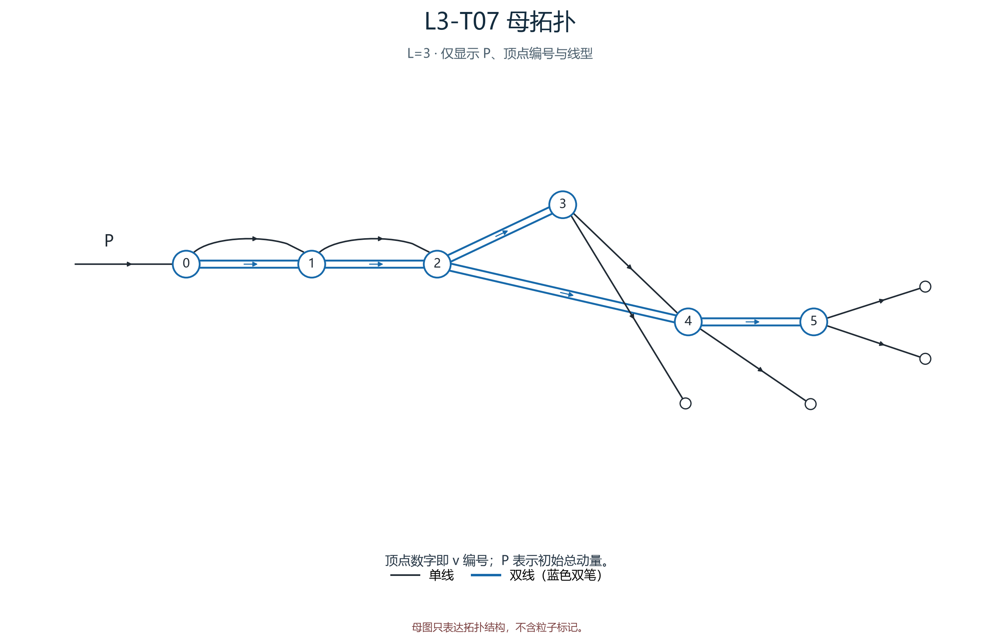
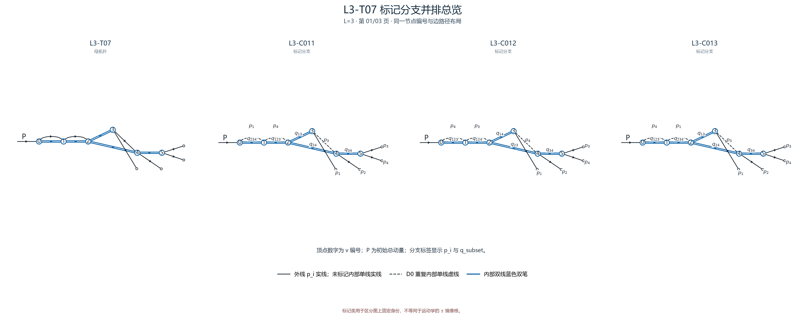
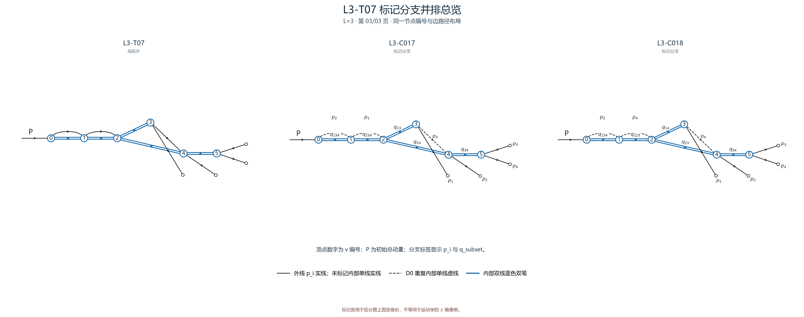

# L3-T07

- 圈数：`3`；标记公式类数：8。
- 返回：[图清单](../01_图清单.md) · [公式清单](../02_公式清单.md) · [审阅入口](../00_开始审阅.md)。

## 拓扑母图

[SVG 原图](../assets/topologies/L3-T07.svg)

## 分页标记总览

### 总览页 1

[PNG 原图](../assets/comparisons/L3-T07_01.png) · [SVG 原图](../assets/comparisons/L3-T07_01.svg)

### 总览页 2

[PNG 原图](../assets/comparisons/L3-T07_02.png) · [SVG 原图](../assets/comparisons/L3-T07_02.svg)

### 总览页 3

[PNG 原图](../assets/comparisons/L3-T07_03.png) · [SVG 原图](../assets/comparisons/L3-T07_03.svg)

## 本拓扑公式分支

| 类别 | 圈数 | 代表图 | 公式页 |
|---|---:|---|---|
| [L3-C011](../公式/L3-C011.md) | 3 | [PNG](../assets/branches/L3-C011.png) · [SVG](../assets/branches/L3-C011.svg) | [六步公式](../公式/L3-C011.md) |
| [L3-C012](../公式/L3-C012.md) | 3 | [PNG](../assets/branches/L3-C012.png) · [SVG](../assets/branches/L3-C012.svg) | [六步公式](../公式/L3-C012.md) |
| [L3-C013](../公式/L3-C013.md) | 3 | [PNG](../assets/branches/L3-C013.png) · [SVG](../assets/branches/L3-C013.svg) | [六步公式](../公式/L3-C013.md) |
| [L3-C014](../公式/L3-C014.md) | 3 | [PNG](../assets/branches/L3-C014.png) · [SVG](../assets/branches/L3-C014.svg) | [六步公式](../公式/L3-C014.md) |
| [L3-C015](../公式/L3-C015.md) | 3 | [PNG](../assets/branches/L3-C015.png) · [SVG](../assets/branches/L3-C015.svg) | [六步公式](../公式/L3-C015.md) |
| [L3-C016](../公式/L3-C016.md) | 3 | [PNG](../assets/branches/L3-C016.png) · [SVG](../assets/branches/L3-C016.svg) | [六步公式](../公式/L3-C016.md) |
| [L3-C017](../公式/L3-C017.md) | 3 | [PNG](../assets/branches/L3-C017.png) · [SVG](../assets/branches/L3-C017.svg) | [六步公式](../公式/L3-C017.md) |
| [L3-C018](../公式/L3-C018.md) | 3 | [PNG](../assets/branches/L3-C018.png) · [SVG](../assets/branches/L3-C018.svg) | [六步公式](../公式/L3-C018.md) |
