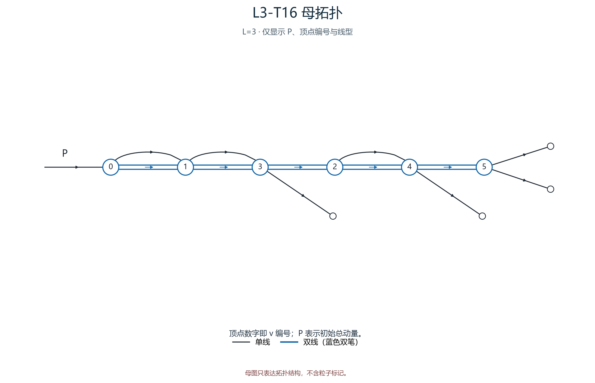
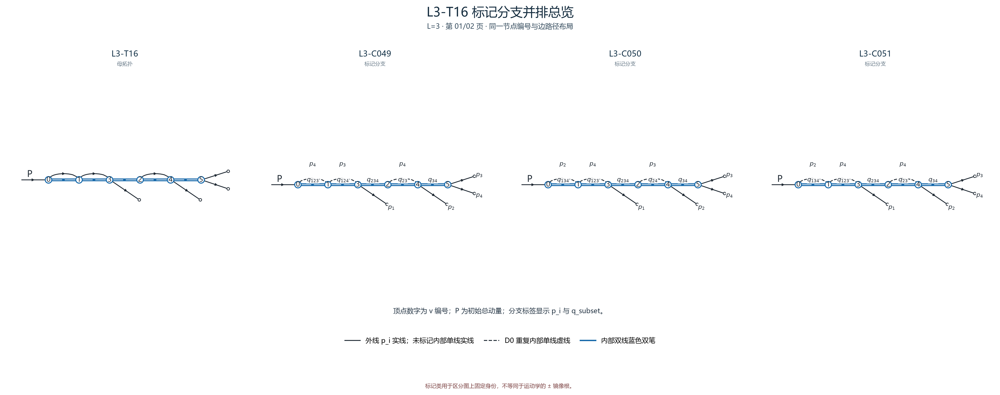

# L3-T16

- 圈数：`3`；标记公式类数：6。
- 返回：[图清单](../01_图清单.md) · [公式清单](../02_公式清单.md) · [审阅入口](../00_开始审阅.md)。

## 拓扑母图

[SVG 原图](../assets/topologies/L3-T16.svg)

## 分页标记总览

### 总览页 1

[PNG 原图](../assets/comparisons/L3-T16_01.png) · [SVG 原图](../assets/comparisons/L3-T16_01.svg)

### 总览页 2

[PNG 原图](../assets/comparisons/L3-T16_02.png) · [SVG 原图](../assets/comparisons/L3-T16_02.svg)

## 本拓扑公式分支

| 类别 | 圈数 | 代表图 | 公式页 |
|---|---:|---|---|
| [L3-C049](../公式/L3-C049.md) | 3 | [PNG](../assets/branches/L3-C049.png) · [SVG](../assets/branches/L3-C049.svg) | [六步公式](../公式/L3-C049.md) |
| [L3-C050](../公式/L3-C050.md) | 3 | [PNG](../assets/branches/L3-C050.png) · [SVG](../assets/branches/L3-C050.svg) | [六步公式](../公式/L3-C050.md) |
| [L3-C051](../公式/L3-C051.md) | 3 | [PNG](../assets/branches/L3-C051.png) · [SVG](../assets/branches/L3-C051.svg) | [六步公式](../公式/L3-C051.md) |
| [L3-C052](../公式/L3-C052.md) | 3 | [PNG](../assets/branches/L3-C052.png) · [SVG](../assets/branches/L3-C052.svg) | [六步公式](../公式/L3-C052.md) |
| [L3-C053](../公式/L3-C053.md) | 3 | [PNG](../assets/branches/L3-C053.png) · [SVG](../assets/branches/L3-C053.svg) | [六步公式](../公式/L3-C053.md) |
| [L3-C054](../公式/L3-C054.md) | 3 | [PNG](../assets/branches/L3-C054.png) · [SVG](../assets/branches/L3-C054.svg) | [六步公式](../公式/L3-C054.md) |
