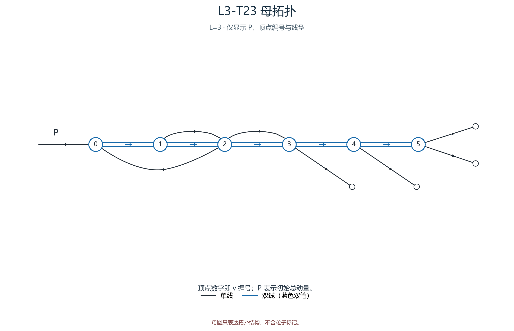
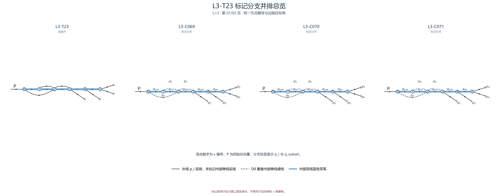

# L3-T23

- 圈数：`3`；标记公式类数：6。
- 返回：[图清单](../01_图清单.md) · [公式清单](../02_公式清单.md) · [审阅入口](../00_开始审阅.md)。

## 拓扑母图

[SVG 原图](../assets/topologies/L3-T23.svg)

## 分页标记总览

### 总览页 1

[PNG 原图](../assets/comparisons/L3-T23_01.png) · [SVG 原图](../assets/comparisons/L3-T23_01.svg)

### 总览页 2

[PNG 原图](../assets/comparisons/L3-T23_02.png) · [SVG 原图](../assets/comparisons/L3-T23_02.svg)

## 本拓扑公式分支

| 类别 | 圈数 | 代表图 | 公式页 |
|---|---:|---|---|
| [L3-C069](../公式/L3-C069.md) | 3 | [PNG](../assets/branches/L3-C069.png) · [SVG](../assets/branches/L3-C069.svg) | [六步公式](../公式/L3-C069.md) |
| [L3-C070](../公式/L3-C070.md) | 3 | [PNG](../assets/branches/L3-C070.png) · [SVG](../assets/branches/L3-C070.svg) | [六步公式](../公式/L3-C070.md) |
| [L3-C071](../公式/L3-C071.md) | 3 | [PNG](../assets/branches/L3-C071.png) · [SVG](../assets/branches/L3-C071.svg) | [六步公式](../公式/L3-C071.md) |
| [L3-C072](../公式/L3-C072.md) | 3 | [PNG](../assets/branches/L3-C072.png) · [SVG](../assets/branches/L3-C072.svg) | [六步公式](../公式/L3-C072.md) |
| [L3-C073](../公式/L3-C073.md) | 3 | [PNG](../assets/branches/L3-C073.png) · [SVG](../assets/branches/L3-C073.svg) | [六步公式](../公式/L3-C073.md) |
| [L3-C074](../公式/L3-C074.md) | 3 | [PNG](../assets/branches/L3-C074.png) · [SVG](../assets/branches/L3-C074.svg) | [六步公式](../公式/L3-C074.md) |
