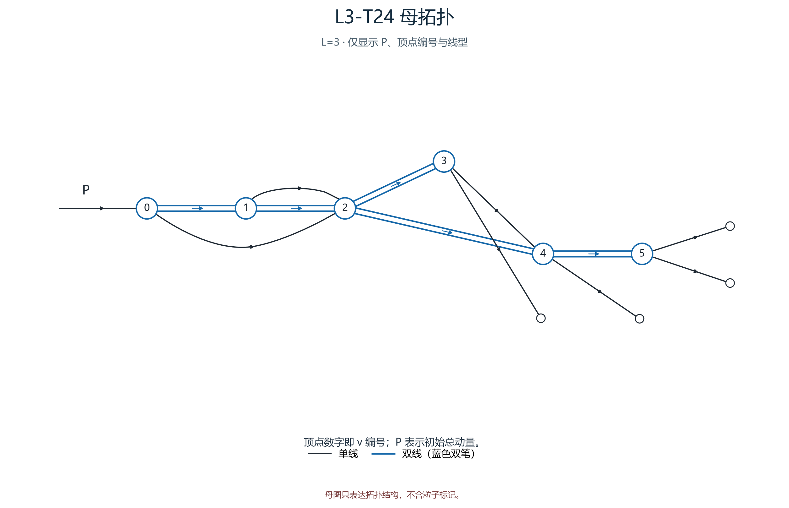
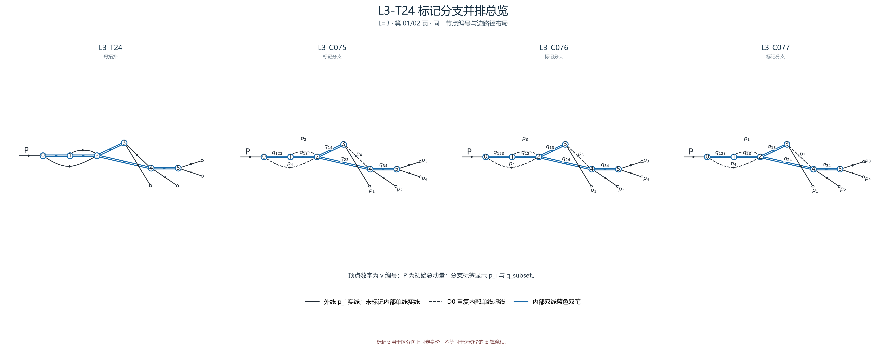
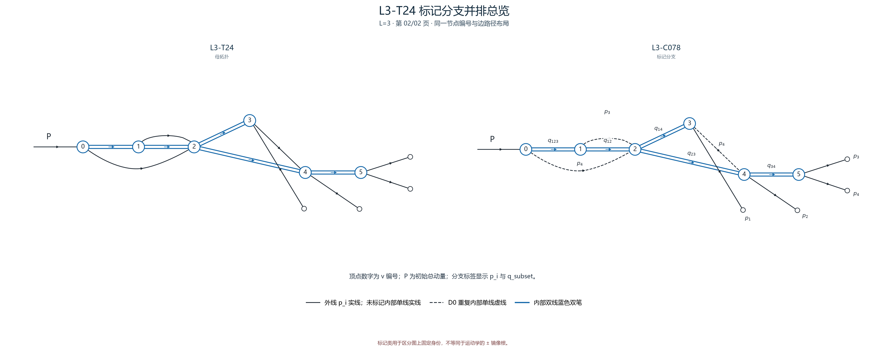

# L3-T24

- 圈数：`3`；标记公式类数：4。
- 返回：[图清单](../01_图清单.md) · [公式清单](../02_公式清单.md) · [审阅入口](../00_开始审阅.md)。

## 拓扑母图

[SVG 原图](../assets/topologies/L3-T24.svg)

## 分页标记总览

### 总览页 1

[PNG 原图](../assets/comparisons/L3-T24_01.png) · [SVG 原图](../assets/comparisons/L3-T24_01.svg)

### 总览页 2

[PNG 原图](../assets/comparisons/L3-T24_02.png) · [SVG 原图](../assets/comparisons/L3-T24_02.svg)

## 本拓扑公式分支

| 类别 | 圈数 | 代表图 | 公式页 |
|---|---:|---|---|
| [L3-C075](../公式/L3-C075.md) | 3 | [PNG](../assets/branches/L3-C075.png) · [SVG](../assets/branches/L3-C075.svg) | [六步公式](../公式/L3-C075.md) |
| [L3-C076](../公式/L3-C076.md) | 3 | [PNG](../assets/branches/L3-C076.png) · [SVG](../assets/branches/L3-C076.svg) | [六步公式](../公式/L3-C076.md) |
| [L3-C077](../公式/L3-C077.md) | 3 | [PNG](../assets/branches/L3-C077.png) · [SVG](../assets/branches/L3-C077.svg) | [六步公式](../公式/L3-C077.md) |
| [L3-C078](../公式/L3-C078.md) | 3 | [PNG](../assets/branches/L3-C078.png) · [SVG](../assets/branches/L3-C078.svg) | [六步公式](../公式/L3-C078.md) |
