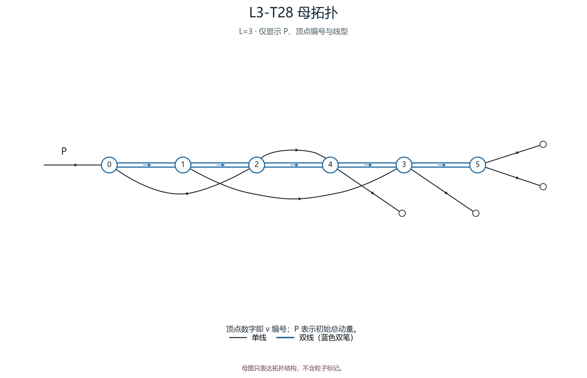
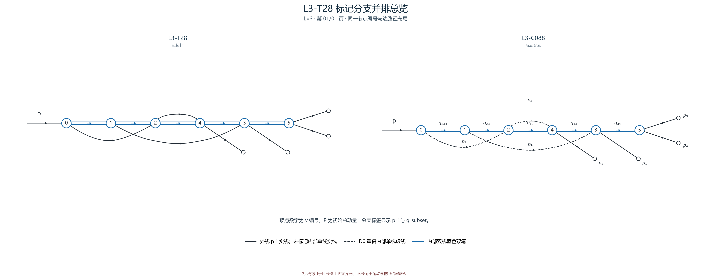

# L3-T28

- 圈数：`3`；标记公式类数：1。
- 返回：[图清单](../01_图清单.md) · [公式清单](../02_公式清单.md) · [审阅入口](../00_开始审阅.md)。

## 拓扑母图

[SVG 原图](../assets/topologies/L3-T28.svg)

## 分页标记总览

### 总览页 1

[PNG 原图](../assets/comparisons/L3-T28_01.png) · [SVG 原图](../assets/comparisons/L3-T28_01.svg)

## 本拓扑公式分支

| 类别 | 圈数 | 代表图 | 公式页 |
|---|---:|---|---|
| [L3-C088](../公式/L3-C088.md) | 3 | [PNG](../assets/branches/L3-C088.png) · [SVG](../assets/branches/L3-C088.svg) | [六步公式](../公式/L3-C088.md) |
