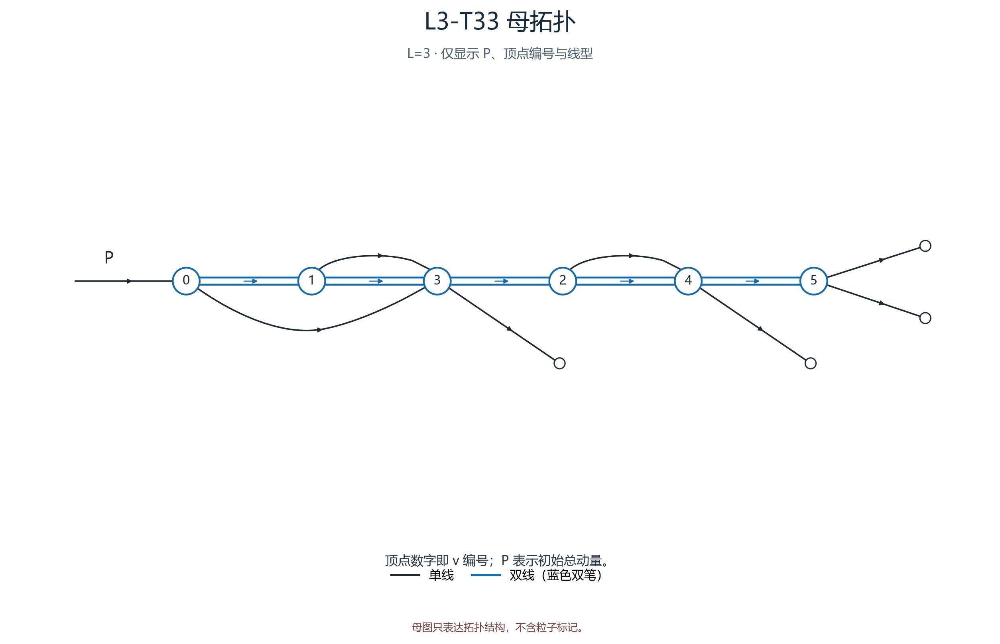
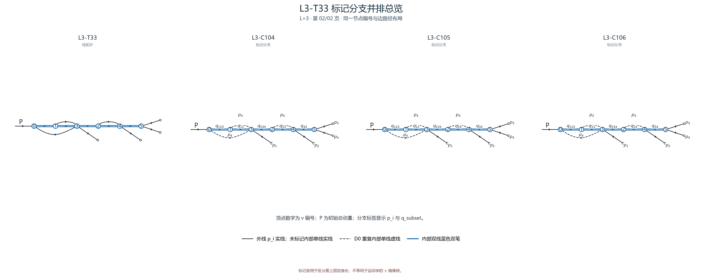

# L3-T33

- 圈数：`3`；标记公式类数：6。
- 返回：[图清单](../01_图清单.md) · [公式清单](../02_公式清单.md) · [审阅入口](../00_开始审阅.md)。

## 拓扑母图

[SVG 原图](../assets/topologies/L3-T33.svg)

## 分页标记总览

### 总览页 1

[PNG 原图](../assets/comparisons/L3-T33_01.png) · [SVG 原图](../assets/comparisons/L3-T33_01.svg)

### 总览页 2

[PNG 原图](../assets/comparisons/L3-T33_02.png) · [SVG 原图](../assets/comparisons/L3-T33_02.svg)

## 本拓扑公式分支

| 类别 | 圈数 | 代表图 | 公式页 |
|---|---:|---|---|
| [L3-C101](../公式/L3-C101.md) | 3 | [PNG](../assets/branches/L3-C101.png) · [SVG](../assets/branches/L3-C101.svg) | [六步公式](../公式/L3-C101.md) |
| [L3-C102](../公式/L3-C102.md) | 3 | [PNG](../assets/branches/L3-C102.png) · [SVG](../assets/branches/L3-C102.svg) | [六步公式](../公式/L3-C102.md) |
| [L3-C103](../公式/L3-C103.md) | 3 | [PNG](../assets/branches/L3-C103.png) · [SVG](../assets/branches/L3-C103.svg) | [六步公式](../公式/L3-C103.md) |
| [L3-C104](../公式/L3-C104.md) | 3 | [PNG](../assets/branches/L3-C104.png) · [SVG](../assets/branches/L3-C104.svg) | [六步公式](../公式/L3-C104.md) |
| [L3-C105](../公式/L3-C105.md) | 3 | [PNG](../assets/branches/L3-C105.png) · [SVG](../assets/branches/L3-C105.svg) | [六步公式](../公式/L3-C105.md) |
| [L3-C106](../公式/L3-C106.md) | 3 | [PNG](../assets/branches/L3-C106.png) · [SVG](../assets/branches/L3-C106.svg) | [六步公式](../公式/L3-C106.md) |
